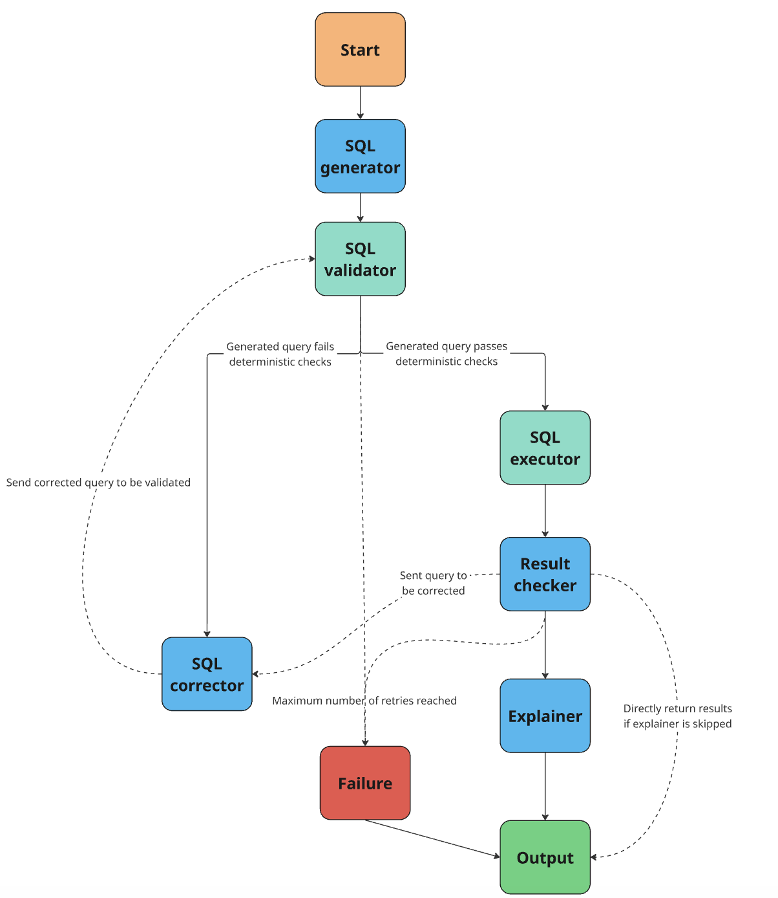
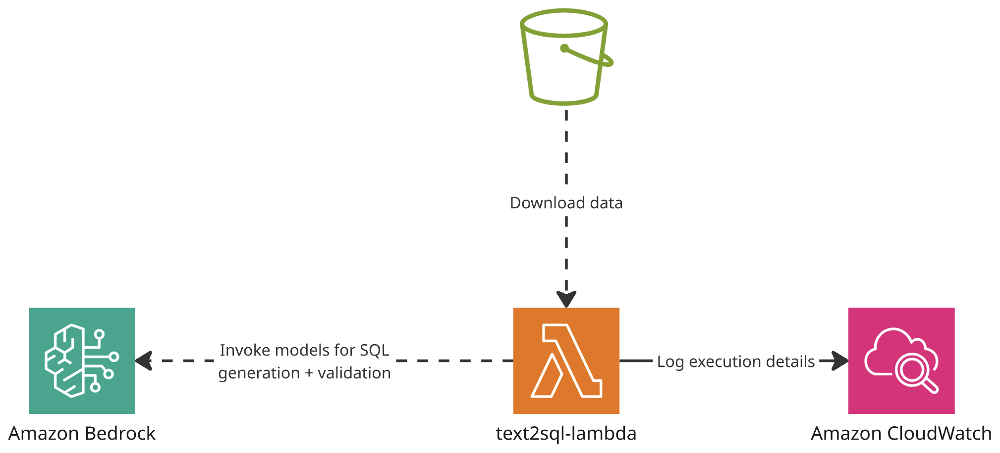

# Text2SQL with LangGraph

This project turns a question in plain English into a SQL query, runs the query and (optionally) answers the question
in a short sentence. The steps are organised as a small workflow built with LangGraph.

The system was built and tested with the [Spider 1.0](https://yale-lily.github.io/spider) dataset. Spider contains
many small SQLite databases and for each of them, questions together with the correct ("gold") SQL query.

There are two ways to run the project:
1. **Locally** on your own computer, with a local LLM. This is where the system was developed and evaluated.
2. **On AWS**, as a Lambda function that uses Amazon Bedrock for the LLM.

## How it works



| Step | What it does | Uses the LLM? |
|---|---|---|
| **generator** | Writes a SQL query from the question and the database schema | yes |
| **validator** | Checks that the query is a single `SELECT` statement that SQLite understands | no |
| **executor** | Runs the query (read-only and with a time limit) | no |
| **checker** | Looks for queries that run but are probably wrong: errors, no rows, only empty values. Optionally, an LLM also judges the result | only the judge |
| **corrector** | Gets the query and the problems found and writes an improved query | yes |
| **explainer** | Answers the question in a short sentence based on the result (optional) | yes |
| **failure** | Gives up when the query still doesn't work after the allowed number of corrections | no |

When the validator or the checker finds a problem, the corrector tries to fix the query, up to `max_corrections` times.
If the corrector returns the same query again, the query is accepted. This happens, for example, when "no rows"
really is the right answer.

## Project structure

- `src` – the code that runs on AWS Lambda:
  - `lambda_entrypoint.py` – entry point of the Lambda function
  - `text2sql/` – the graph and the database functions
  - `common/` – the LLM calls
  - `config/` – the models and settings
- `notebooks` – a notebook with the graph and the evaluation on Spider
- `tests` – the tests
- `terraform` – the AWS infrastructure with one settings file per environment in `environments/`
- `.github/workflows` – the GitHub pipelines for testing, deploying and Terraform
- `documentation` – the images used in this README

## Local setup

### Prerequisites

- Python 3.12, [uv](https://docs.astral.sh/uv/) and [Task](https://taskfile.dev)
- [Ollama](https://ollama.com/download) to run the LLM on your computer

### Steps

1. **Install the Python packages**

   ```bash
   task create-venv
   ```

2. **Download the model**

   ```bash
   ollama pull qwen3:8b
   ```

   To check that the model runs on your GPU, ask a first question and then run `ollama ps`. It should show `100% GPU`.

3. **Download the Spider 1.0 data** from the [Spider website](https://yale-lily.github.io/spider) and unpack it into
   `data/spider/`. The `data/` folder is not stored in git.

   ```
   data/spider/
   ├── dev.json
   ├── train_spider.json
   ├── tables.json
   └── database/<db_id>/<db_id>.sqlite
   ```

4. **Run it**, either in the notebook `notebooks/text2sql.ipynb` (run all cells from the top) or from the command line:

   ```bash
   uv run python src/run_text2sql.py --question "How many singers do we have?" --db-id concert_singer
   ```

### Usage in Python

```python
out = text2sql("How many singers do we have?", "concert_singer")
out["sql"]     # 'SELECT COUNT(*) FROM singer;'
out["rows"]    # [(6,)]
out["answer"]  # 'There are 6 singers in total.'
```

You can change the settings for each call:

```python
text2sql(question, db_id, Settings(check_with_llm=False, max_corrections=1, explain=False))
```

| Setting | Default | Meaning |
|---|---|---|
| `check_with_llm` | `True` | Let an LLM judge the result. If `False`, the checker only runs its simple rule-based checks |
| `max_corrections` | `2` | How often the corrector may try before the graph gives up |
| `explain` | `True` | Answer the question in a sentence at the end |

### Results
The three versions were compared on all 1034 questions of the Spider 1.0 dev set with `qwen3:8b`.
The explainer was switched off for all of them.

- **baseline** – the LLM gets the question and the schema and writes the SQL once, without the graph
- **graph_no_judge** – the graph with the rule-based checks only
- **graph_full** – the graph including the LLM judge

| Version | Accuracy | LLM calls per question | Time per question (typical / slowest 10%) |
|---|---|---|---|
| baseline | 67.6% | 1.0 | 1.3 s / 2.4 s |
| graph_no_judge | 68.3% | 1.1 | 1.2 s / 3.0 s |
| graph_full | **69.0%** | 2.2 | 1.8 s / 4.2 s |

*A question counts as correct when the query returns the same rows as Spider's gold query. The row order only
matters if the gold query sorts.*

What this shows:

- **The graph helps a little.** Compared with the baseline, `graph_full` fixed 17 questions and broke 3.
  `graph_no_judge` fixed 7 and broke none.
- **Every query the graph returns can run.** The baseline wrote 23 queries that don't run. But a query that runs
  can still be wrong, so only a few of these 23 became correct answers.
- **The LLM judge is careful but misses a lot.** It rarely complains about a correct query (4% of the time), but it
  only spots about 1 in 5 wrong ones. It also costs one extra LLM call per question and makes the slowest
  requests almost twice as slow.

In short, the graph improves the accuracy slightly, but it makes each question slower and more expensive.

## AWS deployment

On AWS, the whole system runs inside one Lambda function:



- **AWS Lambda** runs the same graph as the local version. You call it directly with a question and the `db_id` of
  the database. There is no API in front of it.
- **Amazon S3** stores the Lambda code and the SQLite databases. The first time a database is needed, the Lambda
  copies it to its `/tmp` folder and keeps using that copy.
- **Amazon Bedrock** runs all LLM calls. The default model is Qwen3 32B (`qwen.qwen3-32b-v1:0`). Other models can be
  added in `src/config/config.yaml` and chosen per request with `llm_type`.
- **Amazon CloudWatch** stores the logs, including the generated SQL, the number of LLM calls and the time each
  request took.

### Call the function

Send an event like this:

```json
{"question": "How many singers do we have?", "db_id": "concert_singer", "llm_type": "qwen3_32b",
 "check_with_llm": true, "max_corrections": 2, "explain": true, "max_rows": 1000}
```

Only `question` and `db_id` are required. The response contains the query (`sql`), the result (`columns`, `rows`),
the answer (`answer`), whether the graph gave up (`failed`), the last problems found (`errors`), the number of
corrections (`attempts`), the number of LLM calls (`llm_calls`), the time taken (`latency_s`) and every LLM call
with its output (`steps`).

From the command line:

```bash
python src/run_text2sql.py --question "How many singers do we have?" --db-id concert_singer \
    --llm-type qwen3_32b --function-name text2sql-lambda
```


### Steps

1. **Prepare the environment.** Create the S3 bucket for the Terraform state (its name is in
   `terraform/environments/backend-<env>.hcl`) and fill in `account_id` in `terraform/environments/<env>.tfvars`.

2. **Create the infrastructure**, either from your computer:

   ```bash
   task tf:init ENV=dev
   task tf:plan ENV=dev
   task tf:apply ENV=dev
   ```

   or with the GitHub pipelines: first *Terraform Plan*, then *Terraform Apply* with the run ID of the plan.

   The Lambda function can only be created once its code is in the S3 bucket. So the very first time: create the
   infrastructure (this creates the bucket, but fails at the Lambda), run the CI pipeline or upload `lambda.zip`
   yourself, and then create the infrastructure again.

3. **Upload the Spider databases** to the S3 bucket:

   ```bash
   task upload-databases ENV=dev
   ```

### Pipelines

- **CI** runs on every push and pull request. It runs the tests and code checks and builds the Lambda package.
  On `main`, it also uploads the package to S3 and updates the Lambda function.
- **Terraform Plan** (started by hand) shows and saves the changes for an environment.
- **Terraform Apply** (started by hand) applies a saved plan.

The pipelines need these settings in the GitHub environment `dev`:

| Name | Type | Value |
|---|---|---|
| `AWS_ACCESS_KEY_ID`, `AWS_SECRET_ACCESS_KEY` | secret | Access keys of the AWS user that deploys |
| `AWS_REGION` | variable | `eu-central-1` |
| `DEPLOYMENT_BUCKET` | variable | `dev-text2sql-deployment-code` (Terraform output `deployment_bucket`) |
| `LAMBDA_FUNCTION_NAME` | variable | `text2sql-lambda` |

## Possible improvements

The AWS setup is kept as simple as possible. Useful next steps:

- **API Gateway**: put an API in front of the Lambda, so it can be called over HTTPS with login, request limits and
  access logs. One thing to keep in mind: API Gateway stops waiting after 29 seconds and a question that needs
  several corrections can take longer.
- **Caching**
  - **Answers**: save the results in DynamoDB, using the database, the question, the settings and the model as
    the key. A question that was already asked can then be answered without calling the LLM again.
  - **Databases**: at the moment, every new Lambda instance downloads its database from S3. Sharing the databases
    through Amazon EFS would avoid this.
